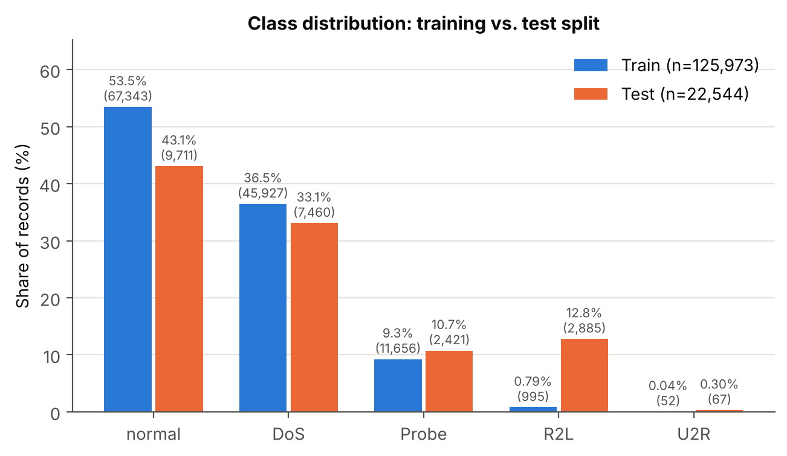
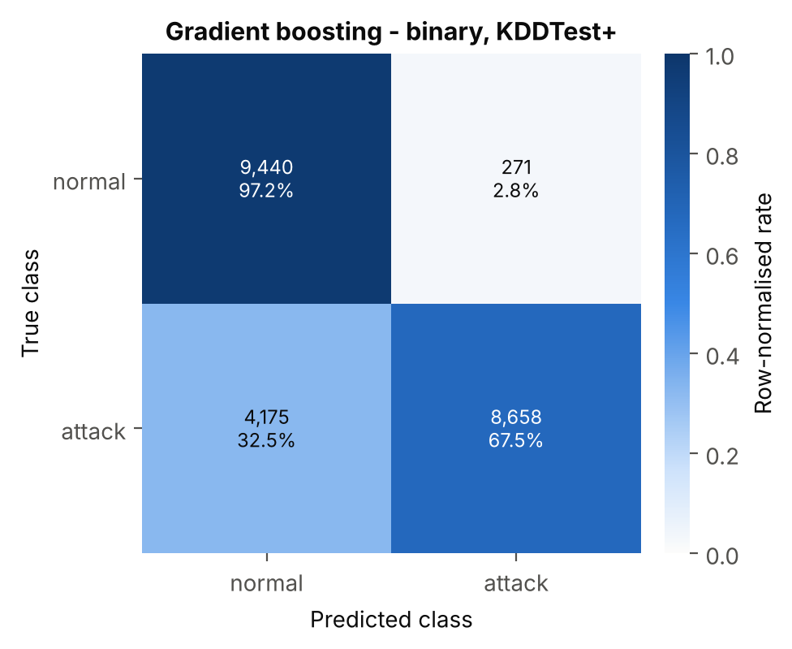
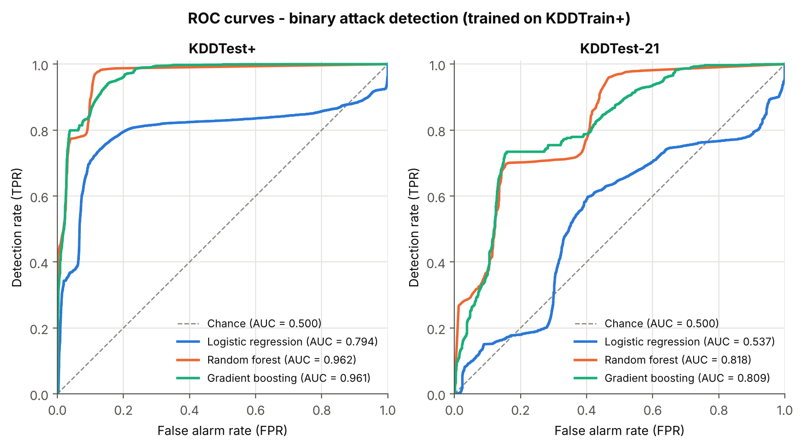
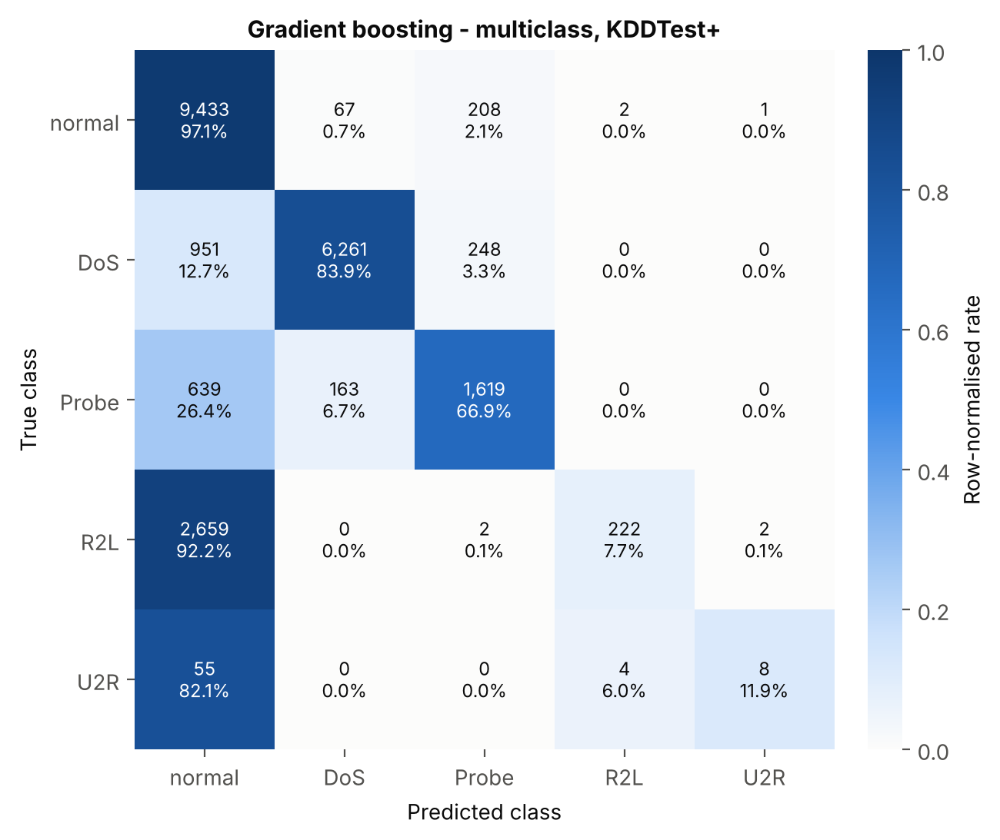
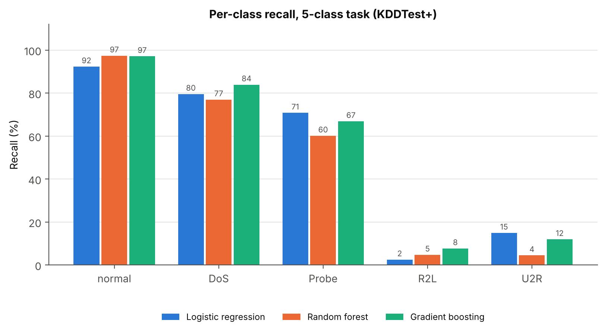
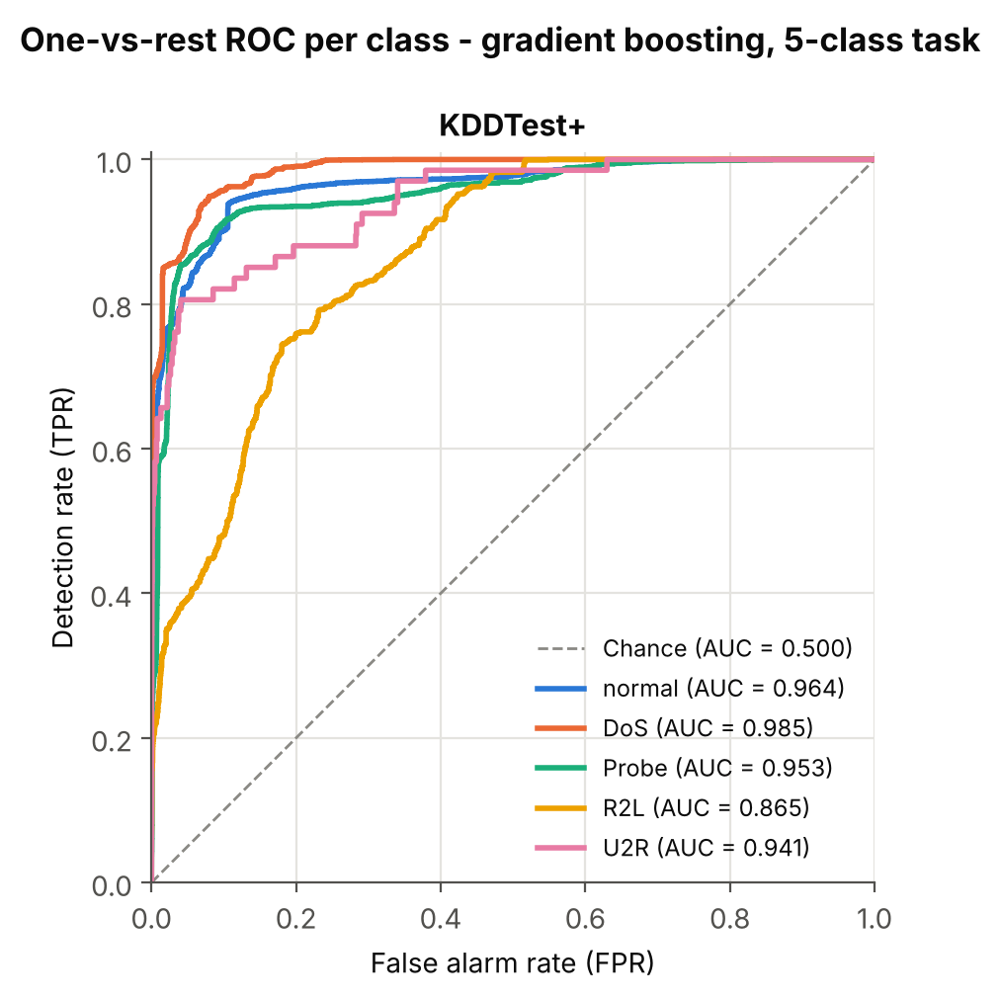
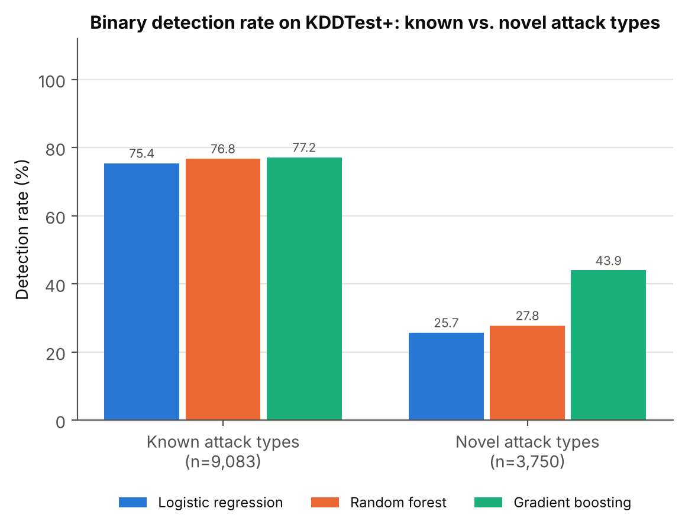
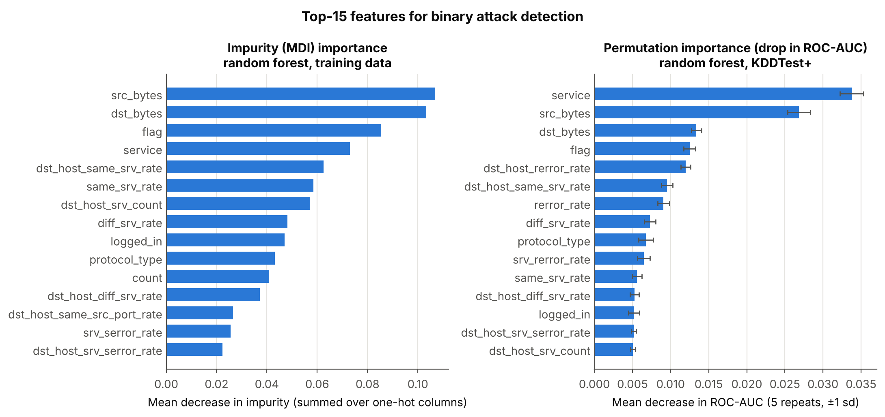

# Closed-World Accuracy, Open-World Failure: An Empirical Study of Machine-Learning Network Intrusion Detection on NSL-KDD

*Research mini-project. All code, data provenance and raw results are in this repository. Every number in this paper is produced by `python run_pipeline.py` and can be traced to a file in `results/`.*

---

## Abstract

Machine-learning (ML) classifiers are often reported to detect network intrusions with
near-perfect accuracy. We revisit that claim on the NSL-KDD benchmark with four
scikit-learn models: a majority-class baseline, logistic regression, a random forest and
histogram gradient boosting. Each model is trained on two tasks: binary detection
(normal vs. attack) and five-class attack categorisation (normal, DoS, Probe, R2L, U2R).
We share one leakage-free preprocessing pipeline across models (one-hot encoding,
log-scaling, standardisation) and evaluate with two protocols.

On a random 20% hold-out of the training file, both tree ensembles reach ≥ 99.9%
accuracy and a ROC-AUC of 1.000. On the official, distribution-shifted test set
KDDTest+, the best model (gradient boosting) reaches 80.3% binary accuracy, 0.796 F1,
0.961 ROC-AUC and a 2.8% false-alarm rate. On the harder KDDTest-21 subset it reaches
62.5%. Its multi-class macro-F1 is 0.554, rising to 0.613 with class re-weighting.

The loss is concentrated in two places. First, the 17 attack types that never appear in
training are detected at only 25.7–44.0%, against 75.4–77.2% for known types. Second,
the rare R2L and U2R classes are almost always labelled *normal*: R2L recall stays at or
below 7.7% without re-weighting. Permutation importance shows that detection relies
mainly on service, byte-count and connection-flag features, which explains why attacks
that imitate normal sessions at the connection level go undetected. We argue that
"closed-world" validation scores should not be reported as evidence of IDS
effectiveness, and we release a reproducible pipeline that reports the open-world
numbers by default.

---

## 1. Introduction

Intrusion detection systems (IDS) monitor hosts or networks for malicious activity and
raise alerts for a human analyst [1]. Production network IDS such as Snort [12] and
Bro/Zeek [13] are mostly *signature-based*. They are precise for known attacks but blind
to anything without a rule. Machine learning promises to generalise from labelled
examples and catch variants that no rule describes. This promise has produced a large
literature, much of it built on the KDD Cup 1999 data and its cleaned successor NSL-KDD
[2, 7].

A recurring problem in this literature is that the evaluation protocol does not match
deployment conditions [5, 6]. Models are often scored with a random train/test split of
a single file. Training and test traffic then come from the same distribution and contain
the same attack tools. In deployment, a detector meets traffic and attacks it has never
seen. NSL-KDD supports a more realistic protocol because its official test file,
KDDTest+, was drawn differently and contains 17 attack types that are absent from the
training file. Many studies nevertheless report only random-split results.

This project measures the gap directly. Our contributions are:

1. **A reproducible, modular pipeline** (`src/`, one entry point). It downloads and
   checksum-verifies NSL-KDD, preprocesses without train/test leakage, trains four
   models on binary and five-class tasks, and writes all metrics and figures.
2. **A side-by-side comparison of closed-world and open-world evaluation** for the same
   models (Section 4.2). Accuracy drops by 20–25 percentage points and ROC-AUC for
   logistic regression falls from 0.998 to 0.794.
3. **A breakdown of where detection fails**:
   * by attack category and attack type (Section 4.4)
   * novel vs. known attack types (Section 4.5)
   * which features the model actually relies on (Section 4.6)
   * whether class re-weighting helps the rare classes (Section 4.7)
4. **An explicit threat model and a list of limitations** (Section 5 and `README.md`).

## 2. Background and Related Work

### 2.1 Intrusion detection systems

Denning's model [1] separates *misuse* (signature) detection, which matches known attack
patterns, from *anomaly* detection, which flags deviations from a profile of normal
behaviour [14]. Network IDS (NIDS) inspect traffic at a vantage point. Host IDS inspect
system calls, logs and files.

Misuse detectors (Snort [12], Zeek scripts [13]) have low false-alarm rates but need a
signature for every attack. Anomaly detectors can in principle find new attacks but
tend to produce many false alarms. This matters because of the *base-rate fallacy* [22]:
when attacks are rare, even a 1% false-positive rate means most alerts are false.
Supervised ML classifiers, as studied here, sit between the two families. They learn
attack patterns from labelled data like a signature system, but over statistical
features rather than exact byte strings, so they may generalise to variants.

### 2.2 Machine-learning approaches

Buczak and Guven [7] survey ML for intrusion detection. The methods range from Bayesian
networks, decision trees and SVMs to clustering, ensembles and neural networks.

* **Tree ensembles.** Random forests [8] and gradient-boosted trees [9, 10] are strong
  baselines on tabular IDS features. They handle mixed categorical/numeric inputs and
  heavy-tailed counts, and they need little tuning.
* **Deep learning.** Javaid et al. [16] applied self-taught learning with a sparse
  autoencoder to NSL-KDD and reported 88.4% binary accuracy on KDDTest+. Yin et al. [15]
  trained a recurrent neural network and reported 83.3% binary and 81.3% five-class
  accuracy on KDDTest+, and 68.6% / 64.7% on KDDTest-21.

Sommer and Paxson [5] argued that ML is a poor fit for intrusion detection when treated
as a closed-world classification problem. Their reasons are the cost of errors, the
diversity of benign traffic, the semantic gap between alerts and actionable insight, and
the difficulty of sound evaluation. Arp et al. [6] later catalogued pitfalls in ML
security research, including sampling bias, data snooping and inappropriate baselines.
Our study is a small, concrete instance of these concerns.

### 2.3 The NSL-KDD dataset

The DARPA 1998 evaluation [4] simulated a US Air Force LAN and injected labelled attacks.
Lee and Stolfo [17] derived 41 connection-level features from the raw tcpdump data, and
these became the KDD Cup 1999 dataset. The features fall into four groups:

* basic TCP features (duration, protocol, service, flag, bytes)
* content features (failed logins, root shells, file creations)
* time-based traffic statistics over a 2-second window
* host-based statistics over the last 100 connections to the same host

McHugh [3] criticised the DARPA data's realism. Tavallaee et al. [2] found that 78% of
KDD'99 training records and 75% of test records were duplicates, which biases learners
toward frequent records. They released **NSL-KDD**, which:

* removes the duplicates
* samples records in inverse proportion to their "difficulty level", defined as the
  number of 21 reference classifiers (7 learners × 3 training runs) that label the record
  correctly
* provides KDDTrain+ (125,973 records), KDDTest+ (22,544) and the hard subset
  KDDTest-21 (11,850 records that not all 21 classifiers got right)

The authors' own reference results on KDDTest+ include 81.1% accuracy for J48, 80.7% for
random forest, 77.4% for an MLP and 69.5% for an SVM. On KDDTest-21 the same models score
64.0%, 63.3%, 57.3% and 42.3% [2].

NSL-KDD is old, and its traffic does not represent modern networks. Newer datasets such
as UNSW-NB15 [18] and CIC-IDS2017 [19] exist, and Ring et al. [20] survey the options.
NSL-KDD nevertheless remains the most widely used benchmark, and its explicitly shifted
test set makes it well suited to the generalisation question we study.

## 3. Methodology

### 3.1 Data acquisition

`src/data.py` downloads `KDDTrain+.txt` and `KDDTest+.txt` from public mirrors and
rejects any file whose SHA-256 differs from the hash pinned in `src/config.py`. The
record counts match the published dataset exactly (Table 1). A schema-identical
synthetic generator (`src/synthetic.py`) exists as an offline fallback and for the smoke
tests. **It was not used for any result in this paper.** `results/run_info.json`
records `data_source = nsl-kdd`.

**Labels.** Each record carries one of 39 attack names (or `normal`). We map them to the
four DARPA categories using the standard taxonomy (`config.ATTACK_CATEGORY`):

* **DoS:** resource exhaustion, e.g. `neptune`, `smurf`, `apache2`
* **Probe:** scanning, e.g. `satan`, `mscan`
* **R2L:** remote-to-local access, e.g. `guess_passwd`, `warezmaster`, `snmpgetattack`
* **U2R:** user-to-root escalation, e.g. `buffer_overflow`, `rootkit`

The binary label is *attack* for any non-normal record.

**Table 1 – Class distribution** (`results/dataset_summary.csv`, Figure 1)

| Category | KDDTrain+ | KDDTest+ | KDDTest-21 |
|---|---:|---:|---:|
| normal | 67,343 (53.5%) | 9,711 (43.1%) | 2,152 (18.2%) |
| DoS | 45,927 (36.5%) | 7,460 (33.1%) | 4,344 (36.7%) |
| Probe | 11,656 (9.3%) | 2,421 (10.7%) | 2,402 (20.3%) |
| R2L | 995 (0.8%) | 2,885 (12.8%) | 2,885 (24.3%) |
| U2R | 52 (0.04%) | 67 (0.3%) | 67 (0.6%) |
| **Total** | 125,973 | 22,544 | 11,850 |

*Figure 1 – Share of each category in the training and test files. R2L grows from 0.8% to
12.8% of records, a 16× change in prior.*

The shift is large. R2L is 16 times more prevalent in KDDTest+ than in training. Of the
12,833 attack records in KDDTest+, 3,750 (29.2%) belong to 17 attack types never seen in
training:

* DoS: `apache2`, `mailbomb`, `processtable`, `udpstorm`, `worm`
* Probe: `mscan`, `saint`
* R2L: `httptunnel`, `named`, `sendmail`, `snmpgetattack`, `snmpguess`, `xlock`, `xsnoop`
* U2R: `ps`, `sqlattack`, `xterm`

### 3.2 Preprocessing

All preprocessing is an sklearn `ColumnTransformer` placed *inside* each model's
`Pipeline`. The encoder vocabulary and scaling statistics are therefore estimated on
training data only.

* **Categorical features** (`protocol_type`, `service`, `flag`; 3, 70 and 11 values) are
  one-hot encoded with `handle_unknown="ignore"`, so an unseen service becomes an
  all-zero vector at test time instead of raising an error.
* **Sixteen heavy-tailed count features** (e.g. `src_bytes`, whose maximum is about
  1.4 × 10⁹; `duration`; `count`) are transformed with log(1 + x) and then standardised.
* **The remaining 21 numeric features** (rates in [0, 1] and binary indicators) are
  standardised.
* `num_outbound_cmds` is constant zero in NSL-KDD and is dropped.

The result is 121 model inputs. Tree models do not need scaling, but sharing one
transformer keeps the comparison controlled.

### 3.3 Models

All models come from scikit-learn [11] (`src/models.py`) and use the fixed seed 42.

| Model | Configuration | Role |
|---|---|---|
| Majority baseline | `DummyClassifier(most_frequent)` | performance floor |
| Logistic regression | L2, C = 1, lbfgs, multinomial for 5 classes | linear, interpretable baseline |
| Random forest [8] | 300 trees, `max_features="sqrt"`, fully grown | bagged tree ensemble |
| Gradient boosting [9, 10] | `HistGradientBoostingClassifier`, 300 iterations, lr = 0.1, 31 leaves, L2 = 1 | boosted tree ensemble |

We deliberately use conventional default hyper-parameters instead of tuning on KDDTest+.
Tuning on the test set is a form of data snooping [6]. A validation split drawn from
KDDTrain+ cannot rank configurations either, because every reasonable model saturates
there (Section 4.2).

### 3.4 Evaluation protocol

1. **Closed-world (in-distribution):** train on a stratified 80% of KDDTrain+ and test
   on the remaining 20%.
2. **Open-world (official):** retrain on all of KDDTrain+ and test on KDDTest+ and
   KDDTest-21.
3. **Ablation:** retrain the five-class models with `class_weight="balanced"`, which
   weights samples inversely to class frequency.
4. **Novel-attack analysis:** measure the binary detection rate separately on test
   records whose attack type does or does not occur in KDDTrain+.
5. **Feature importance:** compute the random forest's mean-decrease-in-impurity (MDI)
   on training data, and its permutation importance on a stratified 5,000-record sample
   of KDDTest+. The permutation score is the drop in ROC-AUC, averaged over 5 repeats.

**Metrics.** For the binary task (positive class = attack) we report accuracy,
precision, recall (detection rate, DR), F1, ROC-AUC and the false-alarm rate
FAR = FP / (FP + TN). For five classes we report:

* accuracy
* macro precision, recall and F1, where every class counts equally, so U2R's 67 test
  records weigh as much as DoS's 7,460
* support-weighted F1
* macro one-vs-rest ROC-AUC
* per-class recall

## 4. Experiments and Results

The full experiment ran in 387 s on a 4-core CPU container (Python 3.13, scikit-learn
1.9.1). Training on the full KDDTrain+ took between 6 s (binary logistic regression) and
60 s (balanced five-class logistic regression) per model (`results/metrics_all.csv`,
column `fit_seconds`). Re-running the pipeline reproduces every number exactly.

### 4.1 Binary detection on the official test sets

**Table 2 – Binary task (normal vs. attack)**, from `results/metrics_comparison_binary.csv`

| Eval. set | Model | Acc. | Prec. | Recall (DR) | F1 | ROC-AUC | FAR |
|---|---|---:|---:|---:|---:|---:|---:|
| KDDTest+ | Majority | 0.431 | 0.000 | 0.000 | 0.000 | 0.500 | 0.000 |
| KDDTest+ | Logistic regression | 0.745 | 0.913 | 0.609 | 0.731 | 0.794 | 0.076 |
| KDDTest+ | Random forest | 0.775 | 0.968 | 0.625 | 0.759 | **0.962** | **0.027** |
| KDDTest+ | Gradient boosting | **0.803** | **0.970** | **0.675** | **0.796** | 0.961 | 0.028 |
| KDDTest-21 | Majority | 0.182 | 0.000 | 0.000 | 0.000 | 0.500 | 0.000 |
| KDDTest-21 | Logistic regression | 0.515 | 0.866 | 0.483 | 0.620 | 0.537 | 0.338 |
| KDDTest-21 | Random forest | 0.571 | 0.949 | 0.503 | 0.658 | **0.818** | **0.123** |
| KDDTest-21 | Gradient boosting | **0.625** | **0.953** | **0.570** | **0.713** | 0.809 | 0.126 |

Gradient boosting has the best accuracy (80.3%) and F1 (0.796) on KDDTest+. The random
forest has a practically identical ROC-AUC (0.962 vs. 0.961). The two ensembles share a
characteristic profile: very high precision (≈ 0.97) and a low false-alarm rate (2.7–2.8%),
but a detection rate of only 62–68%.

The confusion matrix of the boosted model (Figure 2) makes the asymmetry concrete:

* 271 of 9,711 normal connections are falsely flagged.
* 4,175 of 12,833 attacks (32.5%) pass undetected.

So when the detector errs, it almost always errs toward calling an attack *normal*.
Logistic regression is clearly weaker on the shifted data. Its ROC-AUC of 0.537 on
KDDTest-21 is barely above chance, and Figure 3 shows its ROC curve crossing the diagonal.

Our random-forest accuracy (77.5%) is close to, though 3.2 points below, the 80.7% that
Tavallaee et al. [2] report for a Weka random forest. Our KDDTest-21 accuracies (57–62%)
sit in the same 58–66% band as their tree learners. The deep models in [15, 16] report
higher binary accuracies (83–88%). Those models differ in architecture and tuning
procedure, whereas our protocol deliberately uses untuned defaults (Section 3.3), so the
comparison is indicative only.

*Figure 2 – Binary confusion matrix of gradient boosting on KDDTest+. Cells show counts
and row-normalised rates. Confusion matrices for the other models are in
`results/figures/confusion_binary_*.png`.*

*Figure 3 – Binary ROC curves on KDDTest+ (left) and KDDTest-21 (right).*

The ensembles combine a high ROC-AUC (0.96) with a modest detection rate (62–68%). This
means their default 0.5 threshold is conservative under the test-set shift.
`results/operating_points_binary.csv` reads the detection rate off the ROC curve at fixed
false-alarm budgets (Table 2b). These numbers place the threshold using test labels, so
they are an *oracle* diagnostic of ranking quality, not achievable operating points.

**Table 2b – Detection rate at a fixed false-alarm budget (oracle threshold)**

| Eval. set | Model | DR @ FAR ≤ 1% | DR @ FAR ≤ 2% | DR @ FAR ≤ 5% | DR @ FAR ≤ 10% |
|---|---|---:|---:|---:|---:|
| KDDTest+ | Logistic regression | 0.222 | 0.343 | 0.375 | 0.706 |
| KDDTest+ | Random forest | 0.455 | 0.510 | 0.774 | 0.894 |
| KDDTest+ | Gradient boosting | 0.409 | 0.500 | 0.799 | 0.854 |
| KDDTest-21 | Logistic regression | 0.002 | 0.008 | 0.098 | 0.151 |
| KDDTest-21 | Random forest | 0.000 | 0.267 | 0.293 | 0.370 |
| KDDTest-21 | Gradient boosting | 0.099 | 0.136 | 0.253 | 0.362 |

On KDDTest+, accepting a 5% false-alarm rate instead of about 2.8% would raise gradient
boosting's detection rate from 67.5% to 79.9%. A 10% budget would raise the random
forest's to 89.4%. Moving the threshold therefore recovers part of the loss, but only
if the defender knows where to put it. On KDDTest-21 even a 10% false-alarm budget yields
at most 37% detection, so the hard records are not merely mis-thresholded.

### 4.2 Closed-world vs. open-world evaluation

**Table 3 – The same models under the two protocols** (binary task; five-class macro-F1 in the last columns)

| Model | Hold-out acc. | KDDTest+ acc. | Δ | Hold-out AUC | KDDTest+ AUC | Hold-out macro-F1 (5-cl.) | KDDTest+ macro-F1 (5-cl.) |
|---|---:|---:|---:|---:|---:|---:|---:|
| Logistic regression | 0.986 | 0.745 | −24.1 pp | 0.998 | 0.794 | 0.907 | 0.528 |
| Random forest | 0.999 | 0.775 | −22.5 pp | 1.000 | 0.962 | 0.967 | 0.502 |
| Gradient boosting | 0.999 | 0.803 | −19.6 pp | 1.000 | 0.961 | 0.942 | 0.554 |

Under the closed-world protocol the problem looks solved. Both ensembles misclassify
fewer than 25 of 25,195 held-out records (accuracy 0.9992 and 0.9991), and five-class
accuracy is ≥ 99.4% for every non-trivial model. Under the official protocol the same
models lose 20–24 points of accuracy, and five-class macro-F1 roughly halves.

The hold-out numbers also fail to *rank* the models. Random forest and gradient
boosting are indistinguishable on the hold-out (0.9992 vs. 0.9991), yet they differ by
2.8 points on KDDTest+ and 5.4 points on KDDTest-21. A validation split from the
training distribution is therefore of little use for model selection here. This is why
we did not tune hyper-parameters (Section 3.3).

### 4.3 Five-class categorisation

**Table 4 – Five-class task on KDDTest+** (`results/metrics_comparison_multiclass.csv`)

| Model | Acc. | Macro-P | Macro-R | Macro-F1 | Weighted-F1 | Macro AUC (OvR) | Rec. normal | Rec. DoS | Rec. Probe | Rec. R2L | Rec. U2R |
|---|---:|---:|---:|---:|---:|---:|---:|---:|---:|---:|---:|
| Majority | 0.431 | 0.086 | 0.200 | 0.120 | 0.259 | 0.500 | 1.000 | 0.000 | 0.000 | 0.000 | 0.000 |
| Logistic regression | 0.741 | 0.680 | 0.520 | 0.528 | 0.700 | 0.913 | 0.923 | 0.796 | **0.708** | 0.025 | **0.149** |
| Random forest | 0.745 | 0.809 | 0.487 | 0.502 | 0.704 | 0.922 | **0.974** | 0.770 | 0.601 | 0.047 | 0.045 |
| Gradient boosting | **0.778** | **0.826** | **0.535** | **0.554** | **0.740** | **0.942** | 0.971 | **0.839** | 0.669 | **0.077** | 0.119 |

On KDDTest-21, five-class accuracy is 0.507 (logistic regression), 0.516 (random forest)
and 0.578 (gradient boosting), with macro-F1 of 0.420, 0.404 and 0.466 respectively.

Gradient boosting is again the best model overall. The per-class picture (Figures 4
and 5) is the important result:

* **Normal, DoS and Probe** are recognised reasonably well (recall 0.60–0.97).
* **R2L and U2R** are almost entirely missed. Of 2,885 R2L test records, gradient
  boosting assigns 2,659 (92.2%) to *normal* and recovers only 222 (7.7%). Of 67 U2R
  records, 55 (82.1%) are labelled *normal*.
* Errors are not confusions *between* attack types. They are attacks predicted as
  normal traffic. In Figure 4, the "normal" column holds almost all off-diagonal mass.

The one-vs-rest ROC curves (Figure 6) show that the scores still carry information.
R2L reaches an AUC of 0.865 and U2R 0.941, even though the arg-max decision almost never
selects these classes. The classifier ranks R2L records above normal ones more often
than not. What fails is the *decision threshold*, which was set implicitly by the
training-set prior of 0.8% R2L.

*Figure 4 – Five-class confusion matrix of gradient boosting on KDDTest+. Matrices for
the other models are in `results/figures/confusion_multiclass_*.png`.*

*Figure 5 – Per-class recall of the three learned models on KDDTest+.*

*Figure 6 – One-vs-rest ROC curve per class for the five-class gradient-boosting model
on KDDTest+.*

### 4.4 Which attacks are missed?

`results/detection_rate_per_attack_type.csv` gives the binary detection rate per attack
type. The extremes are instructive (rates given as LR / RF / GB):

* **Nearly perfect:** high-volume, statistically loud attacks.
  * `neptune` (SYN flood, 4,657 test records): 99.3 / 99.96 / 99.98%
  * `smurf`: 99.4 / 100 / 100%
  * `satan`: 98.8 / 100 / 100%
  * The new scanner `saint`: 95.6 / 98.4 / 99.4%. It behaves like the known Probe tools.
* **Never detected:**
  * `guess_passwd` (1,231 test records): **0.0%** for all three models, although it is
    a *known* type with 53 training records.
  * `mailbomb` (293): 0%
  * `snmpguess` (331) and `snmpgetattack` (178): ≤ 0.9%
  * `httptunnel` (133): ≤ 1.5%
* **Partially detected:**
  * `warezmaster` (944): 6.7 / 14.2 / 17.1%
  * `mscan` (996): 41.7 / 36.5 / 47.4%
  * `processtable` (685): 0.0 / 0.7 / 33.7%
  * `apache2` (737): 30.8 / 47.2 / 83.2%

The undetected attacks are those whose *connection-level* footprint looks like normal
use of a common service:

* An SNMP GET with a guessed community string is an ordinary SNMP request.
* A mail bomb is a series of well-formed SMTP sessions.
* The `guess_passwd` records in KDDTest+ are single telnet/ftp sessions whose statistics
  differ from the 53 brute-force examples in training.

The last case shows that being "known" does not guarantee detection when the test-time
instances of an attack type are drawn differently.

### 4.5 Novel vs. known attack types

*Figure 7 – Binary detection rate on KDDTest+ attack records whose type occurs in
KDDTrain+ (9,083 records) vs. types absent from it (3,750 records).*

**Table 5 – Known vs. novel attack types** (`results/novel_vs_known_detection.csv`)

| Model | DR known types | DR novel types | Gap |
|---|---:|---:|---:|
| Logistic regression | 75.4% | 25.7% | −49.7 pp |
| Random forest | 76.8% | 27.8% | −49.0 pp |
| Gradient boosting | 77.2% | 44.0% | −33.2 pp |

All models lose most of their detection ability on novel attack types. Gradient
boosting degrades the least, and its 44.0% novel-type detection rate explains most of
its overall advantage. Per-type data show that this comes chiefly from `apache2` (83.2%
vs. 47.2% for the forest) and `processtable` (33.7% vs. 0.7%). Both are DoS variants
whose resource-exhaustion statistics partly overlap with known DoS attacks.

Even for *known* types, detection is only about 77%. The `guess_passwd` and
`warezmaster` records in KDDTest+ alone account for 2,175 known-type attacks, nearly all
of which are missed.

### 4.6 Feature importance

*Figure 8 – Top-15 features of the binary random forest. Left: impurity importance
(training data, one-hot columns summed per original feature). Right: permutation
importance on KDDTest+ (mean ± s.d. of the ROC-AUC drop over 5 repeats).*

Both importance measures (`results/feature_importance.csv`) identify the same core:
`service`, `src_bytes`, `dst_bytes` and `flag`.

* **By impurity:** `src_bytes` (0.107), `dst_bytes` (0.103), `flag` (0.086), `service`
  (0.073).
* **By permutation on the test set:** `service` (0.034 ROC-AUC drop), `src_bytes`
  (0.027), `dst_bytes` (0.013), `flag` (0.012), followed by `dst_host_rerror_rate`
  (0.012).

The two rankings disagree elsewhere:

* `count` and `dst_host_same_src_port_rate` have sizeable impurity importance (0.041
  and 0.026) but near-zero or slightly negative permutation importance (0.0014 and
  −0.0004).
* The REJ-error-rate features (`rerror_rate`, `dst_host_rerror_rate`) are much more
  important on the test set than impurity suggests.

So some structure the forest learned from the training traffic does not transfer, and
impurity importance (which is known to favour high-cardinality and continuous
features [21]) overstates it. All the top features describe *how* a connection behaves
(service, volume, handshake state, error rates), not *what* it carries. Content
features such as `num_failed_logins` and `root_shell` barely register. This explains
why R2L/U2R attacks, whose malice lives in the payload and session semantics, are
invisible to the model.

### 4.7 Ablation: class re-weighting

**Table 6 – Five-class task on KDDTest+, unweighted vs. `class_weight="balanced"`**

| Model | Weights | Acc. | Macro-F1 | Weighted-F1 | Rec. Probe | Rec. R2L | Rec. U2R | Rec. normal |
|---|---|---:|---:|---:|---:|---:|---:|---:|
| Logistic regression | none | 0.741 | 0.528 | 0.700 | 0.708 | 0.025 | 0.149 | 0.923 |
| Logistic regression | balanced | 0.766 | 0.584 | 0.751 | 0.783 | 0.220 | 0.418 | 0.903 |
| Random forest | none | 0.745 | 0.502 | 0.704 | 0.601 | 0.047 | 0.045 | 0.974 |
| Random forest | balanced | 0.743 | 0.512 | 0.698 | 0.627 | 0.019 | 0.104 | 0.972 |
| Gradient boosting | none | 0.778 | 0.554 | 0.740 | 0.669 | 0.077 | 0.119 | 0.971 |
| Gradient boosting | balanced | 0.778 | **0.613** | **0.753** | 0.675 | 0.183 | 0.224 | 0.972 |

Re-weighting has different effects on the three models:

* **Gradient boosting:** macro-F1 rises from 0.554 to 0.613. R2L recall more than
  doubles (7.7% → 18.3%) and U2R recall nearly doubles (11.9% → 22.4%), with no change
  in accuracy and no loss of normal-class recall.
* **Logistic regression:** the gains on the rare classes are even larger (R2L 2.5% →
  22.0%, U2R 14.9% → 41.8%), at a 2-point cost in normal recall.
* **Random forest:** class weights change little, and R2L recall actually falls
  (4.7% → 1.9%). Fully grown trees fit the few rare-class training points perfectly
  whatever their weight. Weights then only influence the impurity of splits near the
  leaves, which has little effect on generalisation.

Even in the best configuration, more than 75% of R2L attacks are still missed.
Re-weighting moves the decision threshold but cannot add information the features
lack.

## 5. Discussion and Limitations

**Closed-world numbers mislead.** The most robust finding is the gap in Table 3. A
practitioner who validated these models on a random split would expect a detector with
a 0.1% error rate. On differently drawn traffic, the same model misses about one attack
in three, and two in three on the hard subset. This is the "closed world" problem
described by Sommer and Paxson [5]: a classifier learns the attacks it was shown, not
the concept of an attack. The *ranking* of models also differs between the protocols,
so random-split validation is unreliable even for model selection.

**What the models are good at.** Under a realistic protocol, tree ensembles are still
useful in a narrow role. They catch volumetric DoS and scanning activity, including new
tools such as `saint`, with a low false-alarm rate (2.7–2.8%) and high precision
(≈ 0.97). For an analyst, an alert from these models is usually real. Their failure
mode is *silent*: missed attacks are labelled normal.

**What they are not good at.** R2L and U2R attacks look normal in connection
statistics. Classical detection of these attacks relies on payload, authentication logs
and host telemetry, which NSL-KDD's few content features capture poorly. More model
capacity will not fix this. The per-class AUCs (Figure 6) suggest some signal remains,
so cost-sensitive thresholds, calibration to the deployment prior, or combining NIDS
scores with host-based evidence are more promising than a bigger classifier.

**Threat model** (see `README.md`). We assume a passive network vantage point that sees
connection summaries, and an attacker who does not adapt to the detector. An adaptive
attacker has an easy job here. The decisive features (`service`, byte counts, `flag`)
are fully under attacker control. Throttling a scan or padding a request would move a
connection into the "normal" region of feature space. We did not evaluate adversarial
evasion or training-data poisoning.

**Limitations.**

1. *Dataset age and realism.* NSL-KDD derives from a 1998 simulated network. Its traffic
   mix, services and attack tools are obsolete, and McHugh's critique of the simulated
   background traffic [3] still applies. The absolute numbers should not be read as
   predictions for a modern network. The *relative* findings (closed vs. open world,
   novel-attack degradation, the R2L blind spot) are the transferable part and should be
   re-checked on modern datasets [18, 19, 20], which have their own labelling issues [23].
2. *Label taxonomy.* A few test-only attacks (e.g. `httptunnel`, `worm`) are assigned
   to different categories in different papers. We use one common mapping, documented
   in `src/config.py`. A different mapping would shift some per-category numbers by a
   few records, but would not change the binary results.
3. *Hyper-parameters.* We used conventional defaults without tuning. Tuned or deep models
   could score a few points higher, as the literature suggests [15, 16]. Without an
   untouched third test set, such gains are hard to separate from test-set overfitting.
4. *Single run.* Results come from one seed. All estimators are deterministic given
   the seed, and the large effects reported here (20+ point gaps) far exceed typical
   seed variance for these models. Small differences, such as 0.962 vs. 0.961 AUC,
   should not be over-interpreted.
5. *Record-level evaluation.* Each connection is classified independently. A real IDS
   would aggregate alerts over time and hosts, which could raise detection of
   multi-connection attacks such as `mscan` while lowering alert volume.
6. *Permutation importance with correlated features.* Many traffic features are strongly
   correlated (e.g. `serror_rate` and `dst_host_serror_rate`). Permuting one of them
   understates its importance because its correlate still carries the information.

## 6. Conclusion

We built a reproducible ML intrusion-detection pipeline on NSL-KDD and compared logistic
regression, a random forest and gradient boosting on binary and five-class tasks. The
best model, histogram gradient boosting, reaches 80.3% accuracy, 0.796 F1, 0.961 ROC-AUC
and a 2.8% false-alarm rate on the official KDDTest+ set. With class re-weighting it
reaches 0.613 macro-F1 on the five-class task.

The same models exceed 99.9% accuracy on a random split of the training data, a
difference of about 20 percentage points. That difference is the central result. It is
driven by attack types never seen in training, which are detected at 26–44% against
75–77% for known types, and by remote-to-local and privilege-escalation attacks, which
look normal at the connection level and are missed more than 75% of the time even with
re-weighting.

ML classifiers over connection features are effective, low-false-alarm detectors for
volumetric and scanning attacks. They are not general intrusion detectors. Evaluations
that train and test on the same distribution substantially overstate their value.
Future work should evaluate on modern datasets with temporally separated splits, use
deployment-prior-aware thresholds, and combine network features with host and payload
evidence for the R2L/U2R classes.

## References

[1] D. E. Denning. An intrusion-detection model. *IEEE Transactions on Software Engineering*, SE-13(2):222–232, 1987.

[2] M. Tavallaee, E. Bagheri, W. Lu, and A. A. Ghorbani. A detailed analysis of the KDD CUP 99 data set. In *Proc. IEEE Symposium on Computational Intelligence for Security and Defense Applications (CISDA)*, pp. 1–6, 2009.

[3] J. McHugh. Testing intrusion detection systems: A critique of the 1998 and 1999 DARPA intrusion detection system evaluations as performed by Lincoln Laboratory. *ACM Transactions on Information and System Security*, 3(4):262–294, 2000.

[4] R. P. Lippmann, D. J. Fried, I. Graf, J. W. Haines, K. R. Kendall, D. McClung, D. Weber, S. E. Webster, D. Wyschogrod, R. K. Cunningham, and M. A. Zissman. Evaluating intrusion detection systems: The 1998 DARPA off-line intrusion detection evaluation. In *Proc. DARPA Information Survivability Conference and Exposition (DISCEX)*, vol. 2, pp. 12–26, 2000.

[5] R. Sommer and V. Paxson. Outside the closed world: On using machine learning for network intrusion detection. In *Proc. IEEE Symposium on Security and Privacy*, pp. 305–316, 2010.

[6] D. Arp, E. Quiring, F. Pendlebury, A. Warnecke, F. Pierazzi, C. Wressnegger, L. Cavallaro, and K. Rieck. Dos and don'ts of machine learning in computer security. In *Proc. 31st USENIX Security Symposium*, 2022.

[7] A. L. Buczak and E. Guven. A survey of data mining and machine learning methods for cyber security intrusion detection. *IEEE Communications Surveys & Tutorials*, 18(2):1153–1176, 2016.

[8] L. Breiman. Random forests. *Machine Learning*, 45(1):5–32, 2001.

[9] J. H. Friedman. Greedy function approximation: A gradient boosting machine. *Annals of Statistics*, 29(5):1189–1232, 2001.

[10] G. Ke, Q. Meng, T. Finley, T. Wang, W. Chen, W. Ma, Q. Ye, and T.-Y. Liu. LightGBM: A highly efficient gradient boosting decision tree. In *Advances in Neural Information Processing Systems 30*, 2017.

[11] F. Pedregosa et al. Scikit-learn: Machine learning in Python. *Journal of Machine Learning Research*, 12:2825–2830, 2011.

[12] M. Roesch. Snort – Lightweight intrusion detection for networks. In *Proc. 13th USENIX Conference on System Administration (LISA)*, pp. 229–238, 1999.

[13] V. Paxson. Bro: A system for detecting network intruders in real-time. *Computer Networks*, 31(23–24):2435–2463, 1999.

[14] V. Chandola, A. Banerjee, and V. Kumar. Anomaly detection: A survey. *ACM Computing Surveys*, 41(3):15:1–15:58, 2009.

[15] C. Yin, Y. Zhu, J. Fei, and X. He. A deep learning approach for intrusion detection using recurrent neural networks. *IEEE Access*, 5:21954–21961, 2017.

[16] A. Javaid, Q. Niyaz, W. Sun, and M. Alam. A deep learning approach for network intrusion detection system. In *Proc. 9th EAI International Conference on Bio-inspired Information and Communications Technologies (BICT)*, pp. 21–26, 2016.

[17] W. Lee and S. J. Stolfo. A framework for constructing features and models for intrusion detection systems. *ACM Transactions on Information and System Security*, 3(4):227–261, 2000.

[18] N. Moustafa and J. Slay. UNSW-NB15: A comprehensive data set for network intrusion detection systems. In *Proc. Military Communications and Information Systems Conference (MilCIS)*, pp. 1–6, 2015.

[19] I. Sharafaldin, A. H. Lashkari, and A. A. Ghorbani. Toward generating a new intrusion detection dataset and intrusion traffic characterization. In *Proc. 4th International Conference on Information Systems Security and Privacy (ICISSP)*, pp. 108–116, 2018.

[20] M. Ring, S. Wunderlich, D. Scheuring, D. Landes, and A. Hotho. A survey of network-based intrusion detection data sets. *Computers & Security*, 86:147–167, 2019.

[21] C. Strobl, A.-L. Boulesteix, A. Zeileis, and T. Hothorn. Bias in random forest variable importance measures: Illustrations, sources and a solution. *BMC Bioinformatics*, 8:25, 2007.

[22] S. Axelsson. The base-rate fallacy and the difficulty of intrusion detection. *ACM Transactions on Information and System Security*, 3(3):186–205, 2000.

[23] G. Engelen, V. Rimmer, and W. Joosen. Troubleshooting an intrusion detection dataset: The CICIDS2017 case study. In *Proc. IEEE Security and Privacy Workshops (SPW)*, 2021.
